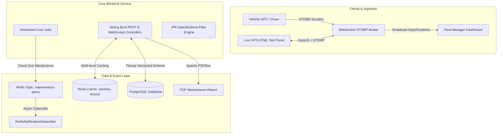

# 🚗 FleetTrack — Real-Time Fleet Telemetry & Management Platform

[](https://www.oracle.com/java/)
[](https://spring.io/projects/spring-boot)
[](https://spring.io/guides/gs/messaging-stomp-websocket/)
[](https://redis.io/)
[](https://www.postgresql.org/)
[](https://flywaydb.org/)
[](https://pdfbox.apache.org/)
[](https://www.docker.com/)

**FleetTrack** is an enterprise-grade vehicle fleet and driver telemetry platform designed for real-time asset tracking, automated maintenance scheduling, distributed event notifications, and PDF report generation.

---

## 🏛 System Architecture

The platform combines real-time bidirectional WebSocket communication, asynchronous Redis Pub/Sub alerting, and scheduled background workers:



---

## ✨ Key Features

* **📡 Real-Time GPS Tracking (WebSocket & STOMP):** Live location ingestion via `/location` endpoint and dynamic fan-out broadcasting to all subscribed clients on `/topic/locations`.
* **🖥️ Built-in Interactive Web Test Panel:** Includes a live browser UI (`/index.html`) using SockJS & STOMP for visual GPS coordinate updates and connection status monitoring.
* **⚡ Event-Driven Maintenance Alerts (Redis Pub/Sub):** `MaintenanceScheduler` runs daily cron jobs (`0 0 9 * * *`), identifies overdue vehicle inspections, and dispatches instant alerts over the `maintenance-alerts` Redis topic.
* **📄 Automated PDF Service Audit Reports:** Uses Apache PDFBox to compile and stream downloadable maintenance history reports (`/api/v1/maintenances/report/pdf`).
* **🚀 Multi-Level Distributed Caching:** Leverages Spring Cache with Redis (`@Cacheable`, `@CachePut`, `@CacheEvict`) for high-frequency driver and vehicle lookups, complete with relational cache invalidation on reassignment.
* **🔍 Dynamic Multi-Criteria Search (JPA Specifications):** Filter vehicles and drivers by status, license plate, model, capacity, and date ranges with paginated metadata.
* **🛡️ Security & RBAC:** Stateless JWT authentication with role-based authorization (`ROLE_ADMIN`, `ROLE_FLEET_MANAGER`, `ROLE_DRIVER`).
* **📦 Database Versioning:** Flyway schema migrations (`V1__init_schema`, `V2__insert_admin`, `V3__fix_admin_password`).

---

## 🛠 Tech Stack

| Component | Technology | Purpose |
| :--- | :--- | :--- |
| **Language & Framework** | Java 17, Spring Boot 3.3.0 | Core backend platform |
| **Real-Time Communication** | Spring WebSocket, STOMP, SockJS | Live GPS telemetry broadcasting |
| **Messaging & Caching** | Redis (Alpine), Spring Data Redis | Pub/Sub alerts & query caching |
| **Relational Database** | PostgreSQL, Spring Data JPA | Relational persistence & Specifications |
| **Schema Migration** | Flyway | Versioned database migrations |
| **Document Generation** | Apache PDFBox | Binary PDF report rendering |
| **Object Mapping** | MapStruct | Type-safe Entity ↔ DTO conversions |
| **Security** | Spring Security 6, JJWT | JWT token authentication & RBAC |
| **Documentation** | SpringDoc OpenAPI (Swagger UI) | Interactive REST API documentation |

---

## 🚀 Quickstart & Setup

### 1. Prerequisites
* **Java 17+**
* **Docker & Docker Compose**

### 2. Start PostgreSQL & Redis
A `docker-compose.yml` is provided at the root:
```bash
docker compose up -d
```
* **PostgreSQL:** Running on port `3241` (mapped to internal `5432`)
* **Redis:** Running on port `6379`

### 3. Run the Application
```bash
./mvnw spring-boot:run
```
* Backend starts at `http://localhost:8080`.
* Swagger API Documentation: `http://localhost:8080/swagger-ui/index.html`

### 4. Test Live GPS Tracking in Browser
Open `http://localhost:8080/index.html` in your browser:
1. Click **"Qoşul (Connect)"** to establish a STOMP WebSocket session.
2. Enter Vehicle ID, Latitude, and Longitude.
3. Click **"Koordinat Göndər"** to broadcast location updates in real time.

---

## 📡 API Endpoints Overview

| Method | Endpoint | Description |
| :--- | :--- | :--- |
| `POST` | `/api/v1/auth/login` | Authenticate user & generate JWT access/refresh tokens |
| `GET` | `/api/v1/vehicles` | Filter vehicles with pagination (JPA Specification) |
| `POST` | `/api/v1/vehicles` | Register vehicle & update Redis cache (`@CachePut`) |
| `GET` | `/api/v1/drivers` | Filter drivers with pagination & vehicle assignments |
| `GET` | `/api/v1/maintenances/report/pdf` | Generate and download PDF maintenance report |
| `WS` | `/location` -> `/topic/locations` | WebSocket STOMP real-time location topic |

---

## 🗺️ Roadmap & Future Enhancements

* [ ] **PostGIS Integration:** Persist spatial telemetry data for historical route replay and trip trajectory analysis.
* [ ] **Geofencing & Speed Alerts:** Real-time boundary-crossing notifications calculated via Redis geospatial indexes (`GEOADD`, `GEORADIUS`).
* [ ] **Kafka Telemetry Migration:** Transition from Redis Pub/Sub to Apache Kafka for persistent, partitioned telemetry ingestion under high concurrent fleet load.
* [ ] **Integration Test Suite:** Comprehensive Testcontainers-based test suite covering WebSocket STOMP and Redis pub/sub flows.

---

## 📄 License
Open-source under the [MIT License](LICENSE).
